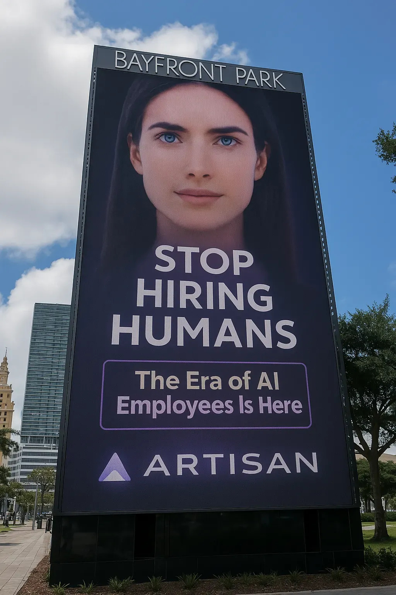

## Tabla de Contenidos

1. [Introducción](#introducción)
2. [Siempre existió un deseo de reemplazar a los desarrolladores](#siempre-existi%c3%b3-un-deseo-de-reemplazar-a-los-desarrolladores)
3. [¿Qué significa ser un desarrollador de Software?](#qu%c3%a9-significa-ser-un-desarrollador-de-software)
4. [El paradigma de Jevons](#el-paradigma-de-jevons)
5. [Conclusión](#conclusi%c3%b3n)
6. [Recursos](#recursos)

## Introducción


Los últimos avances en el desarrollo de la Inteligencia Artificial, especialmente en el campo de la IA generativa, han puesto al alcance de todos herramientas como ChatGPT, Claude, DeepSeek, entre otras, que han revolucionado completamente la manera en la que vemos al mundo y el rol del ser humano en él.

En esa nueva visión existe una tendencia por construir productos y resolver problemas usando solamente Inteligencia Artificial. Lo que se ve reflejado, por ejemplo, en el mensaje provocador de la startup Artisan “Stop Hiring Humans”. 

La verdad es que gran cantidad de actividades, muchas de ellas creativas, parece que pueden ser ejecutadas a través de esta tecnología. Cada día es más común encontrarnos con posts, imágenes, videos, música e incluso series realizadas en su mayoría con estas herramientas y con poca intervención humana. Esto ha puesto sobre la mesa un debate interesante a la vez que alarmante para muchos. ¿Qué profesiones van a desaparecer con la “llegada” de la IA?

Dentro del grupo de profesiones que se dice van a quedar obsoletas es la del “desarrollador de software”. Esto se evidencia en la cantidad de productos que prometen que personas no técnicas puedan escribir código y crear sistemas complejos sin tener conocimientos sobre lenguajes de programación o algún otro elemento relacionado con el software, un ejemplo de ello es el Vibe Coding. 

Andrej Karpathy resumió esta tendencia en X con el siguiente mensaje: “El Inglés es el nuevo lenguaje de programación popular”.

Sin embargo, esta idea no es nueva y la intención de reemplazar a los desarrolladores siempre ha estado ahí. En este blog buscaré argumentar por qué creo que la IA no va a reemplazar a los desarrolladores de software, por el contrario, creará más demanda de profesionales en esta área.

## Siempre existió un deseo de reemplazar a los desarrolladores

En el año de 1959, cuando el uso de las computadoras estaba reservado a los complejos militares y centros de investigación, los lenguajes de programación predominantes eran Assembly o Fortran, lenguajes tan complejos que su uso estaba reservado a unos pocos.

En ese contexto nace COBOL (COmmon Business-Oriented Language), un lenguaje de programación basado en el Inglés cuyo propósito era ofrecer un medio para que personas sin conocimiento en computadoras pudieran programarlas para resolver sus problemas, como los contadores o asesores financieros.

")

COBOL significó para la época pasar de este código escrito en Assembly para sumar dos números

```yaml
section .data
    num1    db 5
    num2    db 7
    result  db 0
    msg     db "Resultado: ", 0
    msglen  equ $ - msg
    newline db 10

section .bss
    buf     resb 20          ; buffer amplio para número en ASCII

section .text
    global _start

_start:
    ; --- suma ---
    mov     al, [num1]
    add     al, [num2]
    mov     [result], al

    ; --- escribir "Resultado: " ---
    mov     rax, 1           ; sys_write
    mov     rdi, 1           ; stdout
    mov     rsi, msg
    mov     rdx, msglen
    syscall

    ; --- convertir result (byte) a decimal en buf ---
    movzx   eax, byte [result]   ; número en EAX
    lea     rdi, [buf + 20]      ; puntero al final
    mov     ebx, 10
    cmp     eax, 0
    jne     .conv
    dec     rdi
    mov     byte [rdi], '0'
    jmp     .done

.conv:
    .loop:
        xor     edx, edx
        div     ebx              ; eax = eax/10, edx = resto
        add     dl, '0'
        dec     rdi
        mov     [rdi], dl
        test    eax, eax
        jnz     .loop

.done:
    ; longitud = (buf+20) - rdi
    mov     rax, buf
    add     rax, 20
    sub     rax, rdi
    mov     rdx, rax            ; rdx = longitud
    mov     rsi, rdi            ; rsi = inicio del número

    ; --- escribir número ---
    mov     rax, 1              ; sys_write
    mov     rdi, 1              ; stdout
    syscall

    ; --- salto de línea ---
    mov     rax, 1
    mov     rdi, 1
    mov     rsi, newline
    mov     rdx, 1
    syscall

    ; --- salir ---
    mov     rax, 60             ; sys_exit
    xor     rdi, rdi
    syscall
```

a este conjunto de sentencias más legibles

```yaml
 IDENTIFICATION DIVISION.
       PROGRAM-ID. SUMA.
       DATA DIVISION.
       WORKING-STORAGE SECTION.
       01 NUM1 PIC 9(2) VALUE 5.
       01 NUM2 PIC 9(2) VALUE 7.
       01 RESULT PIC 9(3).
       PROCEDURE DIVISION.
           ADD NUM1 TO NUM2 GIVING RESULT
           DISPLAY "El resultado es: " RESULT
           STOP RUN.
```

Y esta fue la promesa que hizo COBOL al mundo. No necesitarías personas dedicadas solamente a escribir código, todos podrían hacerlo.

> ❝En la reunión convocada en el Pentágono, a la que asistieron 41 personas, los participantes imaginaron un lenguaje de programación que hiciera uso de un tipo básico de inglés y que permitiera a gerentes, programadores y analistas de sistemas comunicarse con cualquier computadora disponible.❞
> 
> 
> — *FedTech Magazine, “How COBOL Became the Early Backbone of Federal Computing”* (2017)
> 

Pero este propósito no se cumplió. La complejidad que representaba crear sistemas financieros, de pago de nómina o seguros generó una demanda de expertos no solamente en COBOL sino en traducir reglas de negocio en sistemas informáticos eficientes, que puedan operar a través del tiempo. 

De hecho, esta demanda generó que la programación dejara de ser una habilidad más dentro de otras profesiones como las matemáticas o la ingeniería electrónica y se convirtiera en una nueva área como tal: la Ingeniería de Software, en 1968.

De ahí en adelante siempre ha existido la necesidad de que la construcción del software no esté delegada a un grupo de profesionales sino que este al alcance de todos. Esto ha ido desde los 4GL, pasando por CASE Tools o la programación visual, y en los últimos años herramientas de low code, vibe coding e IA generativa.

Que el “Inglés” sea el lenguaje de programación más popular no es una idea nueva de **Andrej Karpathy,** ha sido la misión de la industria desde su creación: construir sistemas simplemente usando lenguaje natural.

Pero así logremos construir un sistema 100% en lenguaje natural, eso no va a eliminar la necesidad de ingenieros o desarrolladores de software, porque su función no está en escribir código, su función va más allá.

## ¿Qué significa ser un desarrollador de Software?

Siempre me llamó la atención ver cómo algunos de mis compañeros de la universidad pasaban horas antes de una prueba de programación estudiando el código, memorizándolo. Eso para mí, nunca tuvo ningún sentido, era poco probable que el ejercicio visto en clase fuera el mismo de la prueba. Los exámenes requerían comprender cómo utilizar un conjunto de sentencias (if, else, for, do while) junto con estructuras de datos (arrays, maps, objects) para resolver un problema, sea el que sea.

> ❝Programas = Algoritmos + Estructuras de Datos.❞
> 
> 
> — Niklaus Wirth, *Algorithms + Data Structures = Programs* (1976)
> 

Con el paso del tiempo he ido comprendiendo también que no soy un desarrollador de Frontend o Backend, o que mi carrera no se define por si desarrollo en JavaScript o Python. He tenido la oportunidad de trabajar con diferentes herramientas y en diversos escenarios, que al final he comprendido lo que soy:  un desarrollador de Software. Pero, ¿qué significa eso para mí?

Ser desarrollador de Software significa contar con un conjunto de habilidades y herramientas (principalmente mentales) que permiten resolver problemas de la vida real a través de sistemas informáticos. Mi trabajo no es escribir código, no es hacer una página web o una API. Mi trabajo es tomar una necesidad como la creación de una cuenta bancaria, con sus reglas y asociaciones e implementarla a través de un sistema.

Pero para llegar a esa implementación es importante comprender el contexto sobre el cual se presenta esa necesidad, entender a las personas que van a utilizar el producto y aquellos que están interesados en crearlo. Además, conocer el conjunto de herramientas que ofrece el mercado para implementar este tipo de soluciones, profundizar en patrones y buenas prácticas, explorar frameworks, de tal manera que los sistemas no funcionen solamente en su lanzamiento, sino que vivan y evolucionen a través del tiempo de manera sustentable.

Creo que esta idea la podría resumir en la siguiente cita:

> ❝Cualquiera puede escribir código que una computadora pueda entender. Los buenos programadores escriben código que los humanos puedan entender.❞
> 
> 
> — Martin Fowler, *Refactoring: Improving the Design of Existing Code* (1999)
> 

Como dice Martin Fowler, cualquiera puede escribir código  que las máquinas entiendan, incluida la IA. Yo le puedo pedir a mi ChatGPT que genere código en Assembly para sumar dos números, cómo el que puse en la sección anterior (y funciona, pueden probarlo). Pero como se declaró en 1968, la ingeniería de software presenta otros retos como: el diseño de sistemas, la abstracción de reglas de negocio, la mantenibilidad, performance, la toma de decisiones en base a presupuestos, equipos y contextos. Ese es un trabajo creativo, ese es un trabajo humano.

## El paradigma de Jevons

En un capítulo del podcast “**Software Architecture Hour with Neal Ford”** que tuvo como invitado a Kent Beck, co creador de Extreme Programming, se planteó esta pregunta: ¿la IA reemplazará a los desarrolladores? 

En ese espacio, que me inspiró para escribir este blog, Kent Beck explica el paradigma de Jevons que describo a continuación:

> **📖 Paradigma de Jevons**
>
> Cuando una innovación tecnológica aumenta la eficiencia con la que se utiliza un recurso, en lugar de reducir su consumo total, a menudo provoca un incremento en la demanda de ese recurso.
> 

Si volvemos al año 1959, cuando nació COBOL, el principal reto era sumar dos números sin matar la memoria. Con COBOL logramos construir sistemas empresariales, el desarrollo de lenguajes de alto nivel como C++ o Java permitieron expandir el uso de las computadoras a la música o el cine, la creación de JavaScript permitió la evolución de la Web, y Python logró que el análisis de datos y el Machine Learning fuera una realidad. Sin cada uno de estos pasos que optimizaron la construcción de software, plataformas como Netflix o Twitch no serían ni siquiera imaginables. 

Kent Beck señala que la inclusión de la Inteligencia Artificial es un paso más en esa optimización. Problemas que antes nos tomaban 4 o 5 horas resolver ahora lo podemos hacer en cuestión de minutos con el apoyo de ChatGPT, Claude o Copilot. 

¿Eso significa que vamos a requerir de menos programadores? La respuesta es no, eso significa que van a existir nuevos casos de uso para la programación, nuevos problemas a resolver que todavía no imaginamos y por ende la necesidad de desarrolladores e ingenieros de software no solo se mantendrá, sino que aumentará.

## Conclusión

La promesa de que la IA va a reemplazar a los desarrolladores de software no es verdadera, ni tampoco nueva. El desarrollo de software va más allá de la creación de código, requiere usar un conjunto de herramientas para resolver problemas y atender necesidades de los usuarios. El llegar a definir esa solución y llevarla a cabo es un tarea humana.

Eso no significa que como desarrolladores o ingenieros nos debemos relajar. Esta nueva era exige de nosotros mayor preparación y estudio. Si la IA me permite resolver un problema de días en horas ¿qué haremos con el tiempo restante? Esa pregunta es clave y quienes aprovechen mejor su tiempo son los que menos riesgo tendrán de dejar de ser relevantes, pero eso es tema para otro post.

Por ahora me gustaría cerrar modificando el mensaje de Artisan: Ve y contrata humanos, su era no ha terminado.


## Recursos

1. Karpathy, A. [@karpathy]. (2023, enero 25). *The hottest new programming language is English* [Tweet]. X. https://x.com/karpathy/status/1617979122625712128
2. The Guardian. (2025, marzo 16). *AI coding threatens programmers’ jobs but experts say human expertise still crucial*. The Guardian. https://www.theguardian.com/technology/2025/mar/16/ai-software-coding-programmer-expertise-jobs-threat
3. FedTech Magazine. (2017, septiembre 18). *How COBOL became the early backbone of federal computing*. FedTech. [https://fedtechmagazine.com/article/2017/09/how-cobol-became-early-backbone-federal-computing](https://fedtechmagazine.com/article/2017/09/how-cobol-became-early-backbone-federal-computing?utm_source=chatgpt.com)
4. IsThisIt.nz. (2022, diciembre 20). *1968 NATO Software Engineering Conference* [Blog post]. [https://isthisit.nz/posts/2022/1968-nato-software-engineering-conference/](https://isthisit.nz/posts/2022/1968-nato-software-engineering-conference/?utm_source=chatgpt.com)
5. Richards, M., & Ford, N. (2021). *Software architecture hour: Evolutionary architecture with Neal Ford and Mark Richards* [Video]. O’Reilly Media. https://learning.oreilly.com/videos/software-architecture-hour/0636920902454/0636920902454-video345197/
